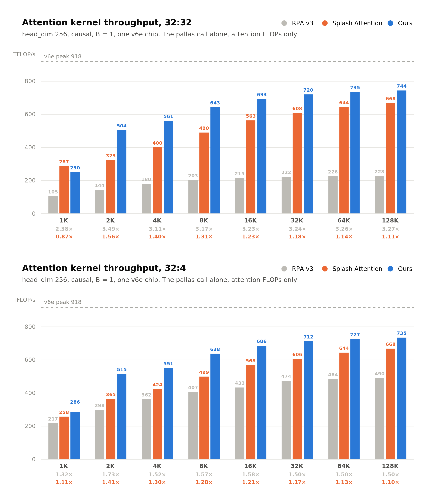
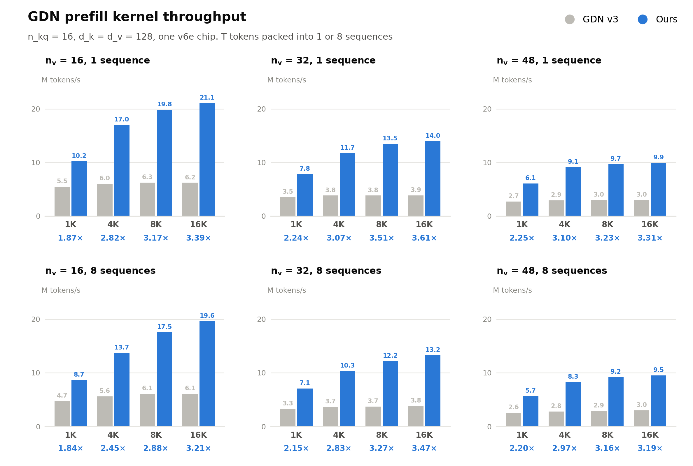

# Benchmarks

The numbers on this page were measured on TPU v6e with `jax[tpu]==0.11.0` and
`libtpu==0.0.44`, the stack tpu-inference runs. The same benchmarks on v7x are
in [v7x.md](v7x.md). Run the commands below from a source checkout, in the venv
of the [README](../README.md#installation)'s `uv sync --extra tpu`.

## Softmax attention

Causal prefill on one v6e chip, head_dim 256, B = 1, for 32:32 (MHA)
and 32:4 (GQA) heads. The rows under each sequence length are our speedup
over [RPA v3](https://github.com/vllm-project/tpu-inference/tree/4420cae/tpu_inference/kernels/ragged_paged_attention/v3) (gray) and [Splash Attention](https://github.com/openxla/tokamax/tree/84e5f36/tokamax/_src/ops/experimental/tpu/splash_attention) (orange).



Every number in the figure comes from
[`benchmarks/softmax_attention/`](../benchmarks/softmax_attention/). Each cell
times a whole attention block under one `jax.jit`, from hidden states
x (B, T, d_model) to hidden states out, with d_model = heads × head_dim:

1. qkv projection: one einsum per q, k and v, each emitting the layout its
   kernel takes, as vLLM's attention layer does;
2. layout: whatever relayout XLA could not fold into the projection;
3. the attention kernel;
4. output projection.

| Backend | Kernel input | Kernel |
|---|---|---|
| flywheel | (B, heads, T, head_dim) | `flash_attn_func` |
| Splash Attention | (B · heads, T, head_dim) | `make_splash_mha_single_device` |
| RPA v3 | (B · T, heads, head_dim) and a paged KV cache | `ragged_paged_attention`, which also writes the cache |

Each cell yields two numbers:

- **Block level**: the median wall clock of the jitted block, from
  back-to-back calls with one sync per round
  ([`common/timing.py`](../benchmarks/common/timing.py)).
- **Kernel level**, which the figure plots: the cell reruns 3 calls under
  `jax.profiler`, and `segments.py` reads the device events of that same
  executable from the trace. Every leaf op goes into one segment by what it
  is: the Pallas call into `attn_kernel`, pure data movement (copy,
  transpose, reshape, slice, pad, dtype conversion, ...) into `layout`, and
  the rest into `qkv_proj` or `out_proj` by its `jax.named_scope`. Anything
  left is reported as `other`. The figure's throughput is attention FLOPs /
  `attn_kernel` time, with attention FLOPs = 4 · B · T² · heads · head_dim,
  halved for causal; the speedup rows are ratios of these throughputs.

Both baselines are loaded from their pinned submodules, with no install, and
each loaded file is checked against its SHA-256 at the pin:
tpu-inference's [RPA v3](https://github.com/vllm-project/tpu-inference/tree/4420cae/tpu_inference/kernels/ragged_paged_attention/v3)
at `4420cae` and Tokamax's [Splash Attention](https://github.com/openxla/tokamax/tree/84e5f36/tokamax/_src/ops/experimental/tpu/splash_attention)
at `84e5f36`. Their block configs come from `rpa_tuned_v6e.json` and
`splash_tuned_v6e.json` next to the script, searched earlier per
(heads, heads_k, head_dim, mask, T) at B = 1 on v6e, with tuners that are not
in this repo. On a v7x chip the script reads `rpa_tuned_v7x.json` and
`splash_tuned_v7x.json` instead, searched with
[`tune_blocks.py`](../benchmarks/softmax_attention/tune_blocks.py). No chip
stands in for another: on one with no tables of its own, the two baselines
are an error until `--rpa-table` and `--splash-table` name a table. The
tables cover every cell of the figure. A cell outside them
runs RPA's `get_default_block_sizes` or Tokamax's heuristic config instead,
and its JSONL record says so in `block_source` / `config_source`. flywheel
runs its own block-size lookup inside `flywheel_tpu`.

To reproduce the figure, sequentially on one v6e chip:

```bash
git submodule update --init third_party/tpu-inference third_party/tokamax
benchmarks/softmax_attention/attention_block.sh results/benchmark/softmax_attention
```

The defaults are the figure's grid: RPA v3, Splash Attention and flywheel,
32 q heads with 32 or 4 kv heads, head_dim 256, causal, B = 1, T from 1K to
128K. `IMPLS`, `HEADS`, `HEADS_K`, `HEAD_DIM`, `MASK` and `SEQLENS` override
them. The output directory gets `benchmark.jsonl`, `benchmark.log` and one
profiler trace per cell under `traces/`, which XProf opens. At the end the
script prints the kernel-level table the figure plots and the block-level
split, which shows the layout work RPA v3 does before its kernel runs and
flywheel and Splash Attention do not need. Rerunning into the same directory
measures every cell again, and the last ok record of each cell wins.

To time one cell, reprint the tables, or re-split a directory of traces:

```bash
PYTHONPATH=. uv run --no-sync python benchmarks/softmax_attention/attention_block.py \
    --impl flywheel --heads 32 --heads-k 4 --head-dim 256 --seq 8192 \
    --output results/benchmark/softmax_attention/benchmark.jsonl \
    --trace results/benchmark/softmax_attention/traces
PYTHONPATH=. uv run --no-sync python benchmarks/softmax_attention/report.py \
    results/benchmark/softmax_attention/benchmark.jsonl
PYTHONPATH=. uv run --no-sync python benchmarks/softmax_attention/segments.py \
    results/benchmark/softmax_attention/traces
```

Only fixed-shape prefill is benchmarked; the varlen and KV-cache APIs have
no benchmark entrypoint.

## Linear attention

GDN prefill on one v6e chip, n_kq = 16 and d_k = d_v = 128, with T tokens
packed into 1 or 8 sequences. The row under each sequence length is our
speedup over the vendored `gdn_v3` baseline (gray).



For GDN and KDA kernels, the vendored baselines live in
`benchmarks/linear_attention/baseline_kernel/`. The GDN benchmark compares
`gdn_v3` with our fused kernel by default; KDA's `--impl baseline` times the
chunked forward baseline, while `--pkgs` times fused kernels:

```bash
PYTHONPATH=. uv run --no-sync python benchmarks/linear_attention/benchmark/bench_gdn_fwd.py \
    --output results/gdn_fwd.json
PYTHONPATH=. uv run --no-sync python benchmarks/linear_attention/benchmark/bench_kda_fwd.py \
    --pkgs flywheel_tpu.linear_attention.kda --output results/kda_fwd.json
PYTHONPATH=. uv run --no-sync python benchmarks/linear_attention/benchmark/bench_kda_fwd.py \
    --impl baseline --output results/kda_fwd_baseline.json
```

