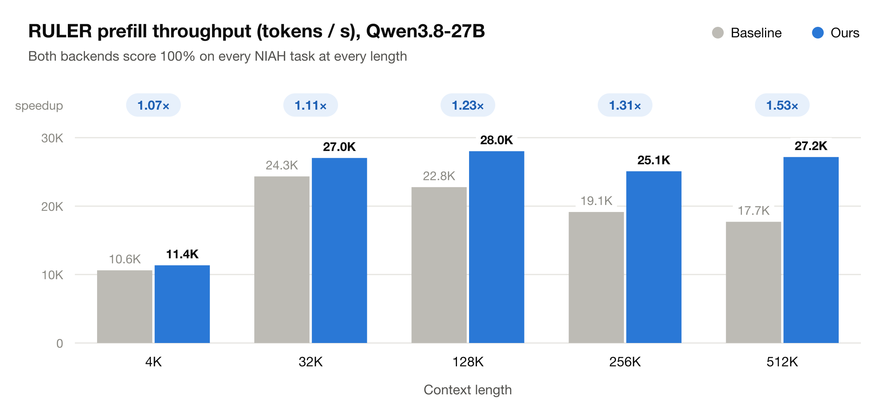
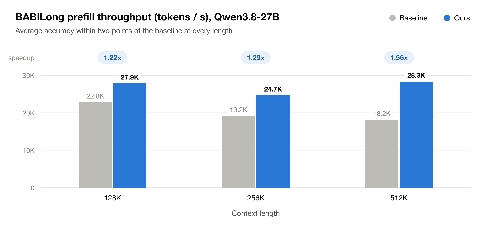
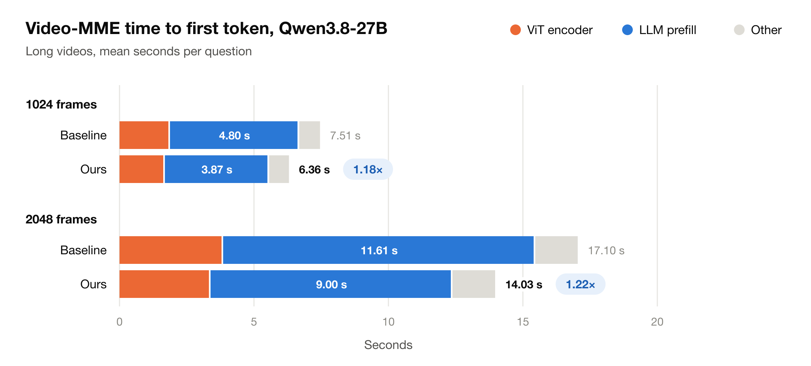

# End-to-end Evaluation

This page reproduces the paper's end-to-end results: Qwen3.8-27B served by
vLLM on TPU, with flywheel's kernels against tpu-inference's own, on RULER,
BABILong and Video-MME. The runs use this repo's patched tpu-inference,
described below. The same evaluation on v7x is in [v7x.md](v7x.md#end-to-end-evaluation).

## Results

Qwen3.8-27B in bf16 on one TPU v6e-8 host (`--tp-size 8`); the 512K points
run on two v6e-8 hosts with `--cp-size 2 --enable-sp --yarn-factor 2`.
`flywheel` sets `USE_FLYWHEEL_TPU_KERNEL=1` and
`USE_FLYWHEEL_TPU_LINEAR_KERNEL=1`. `baseline` is the same backend with both
off: RPA v3 with the mixed block sizes of
[`eval/configs`](../eval/configs/qwen38_27b_tp8_rpa_mixed_blocks.json), and
`gdn_v3`.







## vLLM backend (tpu-inference)

The vLLM TPU backend is upstream
[tpu-inference](https://github.com/vllm-project/tpu-inference) pinned as the
`third_party/tpu-inference` submodule, plus [`patches/tpu-inference.patch`](../patches/tpu-inference.patch),
which routes attention and GDN/KDA linear attention to the kernels in this
repo. On a TPU VM, from a checkout of this repo (needs
[just](https://github.com/casey/just) and [uv](https://github.com/astral-sh/uv)):

```bash
# 1. Check out the pinned tpu-inference and apply the patch.
just tpu-inference-apply

# 2. Clone vLLM at the commit the pinned tpu-inference is validated against.
git clone https://github.com/vllm-project/vllm.git ../vllm
git -C ../vllm checkout "$(cat third_party/tpu-inference/.buildkite/vllm_lkg.version)"

# 3. Install vLLM, the patched tpu-inference, and flywheel_tpu into one venv.
sudo apt-get update && sudo apt-get install -y libopenblas-base libopenmpi-dev libomp-dev
uv venv vllm_env --python 3.12 && source vllm_env/bin/activate
(cd ../vllm && uv pip install -r requirements/tpu.txt --torch-backend=cpu \
  && VLLM_TARGET_DEVICE=tpu uv pip install -e . --no-build-isolation)
uv pip install -e third_party/tpu-inference -e .
```

The kernels are off by default and switched on per attention family:

```bash
USE_FLYWHEEL_TPU_KERNEL=1 \
USE_FLYWHEEL_TPU_LINEAR_KERNEL=1 \
vllm serve Qwen/Qwen3-4B
```

`USE_FLYWHEEL_TPU_KERNEL` replaces RPA v3 for softmax attention and
`USE_FLYWHEEL_TPU_LINEAR_KERNEL` replaces the GDN/KDA kernels of hybrid
models. A configuration a kernel cannot serve fails instead of falling back
to the upstream kernel.

To change the backend, edit `third_party/tpu-inference` in place (the patch
stays uncommitted on top of the pin) and run `just tpu-inference-export` to
write the changes back into the patch. `just tpu-inference-bump <rev>` moves
the pin to a newer upstream commit and re-applies the patch with a 3-way
merge, stopping on conflicts.

## Setup

On every host, with the venv of the vLLM backend section activated:

```bash
eval/setup.sh deps                            
eval/setup.sh model                           
eval/setup.sh ruler                           
eval/setup.sh babilong --lengths "128k 256k"  
eval/setup.sh videomme                        
```

The runs themselves are offline. Each sweep runs its points one after
another and skips the ones that already finished, so an interrupted sweep
picks up where it stopped. Results go to `~/eval-logs/<eval>` unless `--out`
names another directory, and `--tp-size` (default 8) sets the tensor
parallelism. These commands and scripts assume a single host that holds every
chip of the run (e.g. a v6e-8 at the default `--tp-size 8`); on a machine of
several hosts, adapt them by hand and start Ray first, as in the multi-host
example below:

```bash
eval/ruler/run_ruler_sweep.sh --seqlens "4096 32768 131072"
eval/babilong/run_babilong_sweep.sh --lengths "128k 256k"
eval/videomme/run_videomme_sweep.sh --frames "1024 2048"
```

To run on multiple hosts:

```bash
eval/setup.sh babilong --lengths 512k    # on the host that runs the eval
ray start --head --port=6379             # on the host that runs the eval
ray start --address=<head ip>:6379       # on every other host
eval/babilong/run_babilong_sweep.sh --lengths 512k --cp-size 2 --enable-sp \
    --yarn-factor 2 --multihost --out ~/eval-logs/babilong
eval/ruler/run_ruler_sweep.sh --seqlens 524288 --cp-size 2 --enable-sp \
    --yarn-factor 2 --multihost --out ~/eval-logs/ruler
```

Start Ray without `USE_FLYWHEEL_TPU_*` or `RPA_V3_*` set: the driver's kernel
switches reach the Ray workers only where a node does not already set them.

